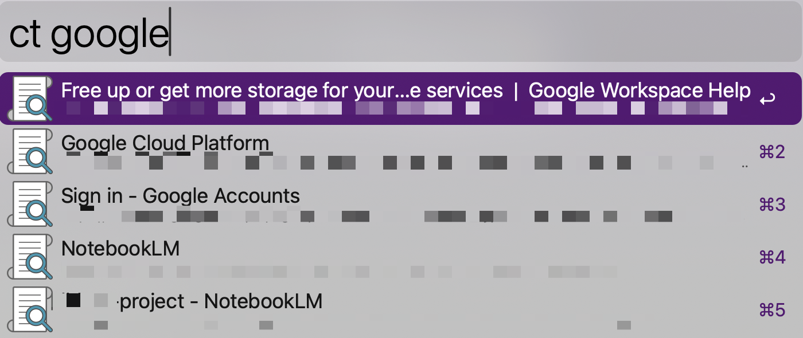

# Comet Tabs for Alfred

Instantly search and switch to any open [Comet](https://browser.comet.com/) tab from Alfred — across all windows and desktops. Also comes in Google Chrome and Comet + Chrome flavors.




## Features

- **Fuzzy search** all open tabs across every window
- **Switches desktops reliably** — brings the exact window forward on the first try, even when it's on another macOS Space or two windows share the same title
- **Duplicate tabs flagged** — `⧉ Open 2×` when the same page is open more than once; type `ct dup` to list them
- **Current tab marked** with `● Current tab`
- **Close or copy from the keyboard** — `⌥↩` closes a tab, `⌘↩` copies its URL
- **Instant** — the list appears immediately from cache and refreshes in the background

## Installation

Download one or more of these and double-click to install in Alfred:

| Package | Keyword | Searches |
|---|---|---|
| [`Comet-Tabs.alfredworkflow`](./Comet-Tabs.alfredworkflow) | `ct` | Comet |
| [`Chrome-Tabs.alfredworkflow`](./Chrome-Tabs.alfredworkflow) | `gt` | Google Chrome |
| [`All-Tabs.alfredworkflow`](./All-Tabs.alfredworkflow) | `at` | Comet and Chrome together |

**Requirements:**
- [Alfred 5.5+](https://www.alfredapp.com/) with Powerpack
- [Comet](https://browser.comet.com/) and/or Google Chrome
- macOS 13+ (Apple Silicon or Intel)
- Alfred needs **Accessibility** permission (System Settings → Privacy & Security → Accessibility) to bring windows forward

If macOS blocks the bundled `raise-window` helper ("cannot verify… malware") after downloading, clear the quarantine flag on the installed workflow folder: right-click the workflow in Alfred → *Open in Finder*, then run `xattr -dr com.apple.quarantine .` in that folder.

## Usage

| Key | What it does |
|--------|-------------|
| `ct {query}` | Search all open tabs |
| `↩` | Switch to the tab (and its desktop) |
| `⌘↩` or `⌘C` | Copy the tab's URL |
| `⌥↩` | Close the tab |
| `⇧` | Quick Look preview |
| `ct dup` | Show only duplicate tabs |
| `ct current` | Find the tab you're on |

## How it works

- **`list-tabs.js`** (JXA) lists every tab, counts duplicate URLs (http/https only, ignoring `#fragments` and trailing slashes) and returns Alfred JSON with a 5-second cache.
- **`focus-tab.js`** (JXA) finds the tab by window id (re-finding it by URL if it moved), selects it, then briefly renames the window to a unique tag via the browser's "Name Window" scripting property and calls the helper. The original name is restored right after.
- **`raise-window`** (Swift, source in `raise-window.swift`) finds the tagged window even on another Space and switches to it. System Events can only see windows on the current Space, so it uses the same private Accessibility / SkyLight calls as [AltTab](https://github.com/lwouis/alt-tab-macos): `_AXUIElementCreateWithRemoteToken` to reach every window, then `_SLPSSetFrontProcessWithOptions` + `AXRaise` to bring it forward. Window element ids are cached so later lookups are fast.

`NOTES.md` has the full debugging history — why earlier versions sometimes needed two tries.

## Building from source

```bash
# universal helper
swiftc -O -target arm64-apple-macos13  raise-window.swift -o rw-arm64  -F /System/Library/PrivateFrameworks -framework SkyLight
swiftc -O -target x86_64-apple-macos13 raise-window.swift -o rw-x86_64 -F /System/Library/PrivateFrameworks -framework SkyLight
lipo -create rw-arm64 rw-x86_64 -output raise-window && codesign -s - -f raise-window

# package
zip -X Comet-Tabs.alfredworkflow info.plist list-tabs.js focus-tab.js raise-window
```

For the Chrome / All packages, zip `variants/chrome/info.plist` or `variants/all/info.plist` (copied to a folder as `info.plist`) together with the same three files. For development you can symlink `variants/chrome` and `variants/all` into Alfred's workflows folder so all three keywords share one copy of the scripts.

## Changelog

### 1.1.0
- **Fixed for good:** selecting a tab sometimes still needed two tries. Two causes: windows were looked up by list position, which shifted after reordering; and System Events only sees windows on the current Space, so windows on other desktops were never found. Now tabs are tracked by window id, and a small helper reaches windows on any Space and switches to them.
- **New:** duplicate-tab badge (`⧉ Open N×`, `ct dup`), `● Current tab` marker, domain-only subtitles.
- **New:** `⌥↩` closes a tab, `⌘↩` copies its URL, `⇧` Quick Look.
- **New:** instant results via Alfred's Script Filter cache.
- **New:** Google Chrome (`gt`) and Comet + Chrome (`at`) workflows.
- **New:** a notification when a tab is gone or a window can't be brought forward.
- Windows with identical titles are told apart exactly.

### 1.0.1
- **Fixed:** selecting a tab sometimes required two attempts to bring it forward — especially across multiple monitors/Spaces. The window-raise logic read the window title only 50 ms after switching tabs, before it had updated to the new tab, so the first attempt matched the wrong window. It now waits for the title to settle before activating, re-asserts Comet as frontmost during the raise, and extends the retry deadline.

### 1.0.0
- Initial release: fuzzy-search and switch to any open Comet tab across all windows and Spaces.

## License

MIT
